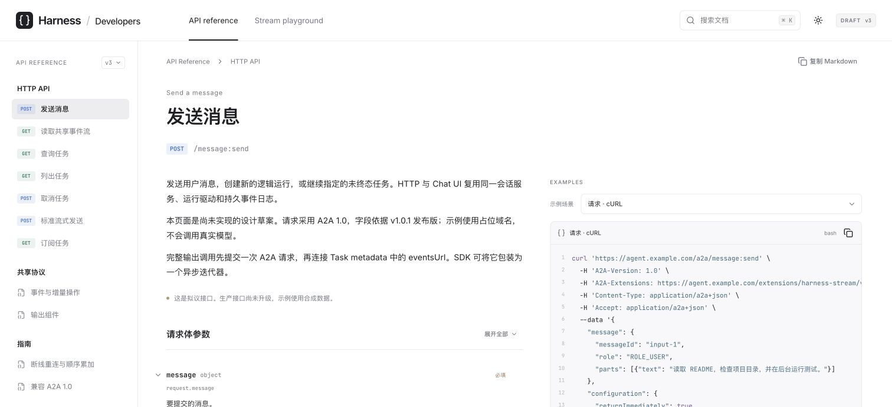

# Harness 共享流协议：设计与交付材料

> 2026-10-22：本目录的 A2A 兼容方案与 v3 流协议已废弃，不再推进。对外接口以
> [Agent API v1](../../architecture/agent-api-v1.md) 为准；本目录仅作历史参考。

本目录集中本次关于 Claude、Pi、Codex 运行事件、共享 HTTP/WS 流、A2A 1.0 兼容和交互式 API 文档站的讨论成果。整理日期：2026-10-17。

协议仍是设计草案，未修改生产运行时接口。它只供平台外部客户端使用，当前 Chat UI 不消费此协议；可复用底层运行驱动和事件来源。站点只做桌面本地预览，演示数据为合成事件。

## 目录

```text
harness-stream/
├── README.md                         本入口
├── architecture/
│   ├── harness-stream-protocol-v3-draft.md  背景、比较、架构与旧版方案
│   └── api-reference-site.md          已确认的文档站设计
├── api/
│   ├── harness-http-api-reference.md  最新：请求、返回与增量协议
│   ├── harness-stream-v3.md           旧版完整组件替换契约
│   ├── harness-stream-v3.schema.json   旧版机器 Schema
│   └── examples/
│       ├── harness-stream-v3-delta-proposal/  最新增量 SSE / JSONL / 重连
│       └── harness-stream-v3/         旧版样例与 A2A 投影
├── site/                             可交互参考站源码、下载文件与测试
├── research/
│   ├── harness-response-reference.md  返回字段研究底稿
│   └── authoring/                    历史生成脚本文本
├── tests/
│   ├── verify-harness-http-reference.cjs    增量样例与文档验证
│   ├── validate-harness-stream-v3.cjs       旧契约校验与类型检查
│   └── fixtures/legacy/              旧版类型及样例快照
└── assets/
    └── harness-api-reference-preview.png   交付预览截图
```

## 阅读顺序与版本边界

1. [最新 HTTP API 参考](api/harness-http-api-reference.md)：请求参数、完整返回路径、`splice` / `set` / `text.append`、后台任务、重连及 A2A 1.0。实施新接口时优先读这份。
2. [架构与 Harness 对比](architecture/harness-stream-protocol-v3-draft.md)：复用现有事件采集、面向外部客户端、原生事件完整性、tmux 边界、子 agent 与 A2A 扩展；正文保留旧方案供对照，其中 Chat UI v3 迁移已取消。
3. [增量完整流](api/examples/harness-stream-v3-delta-proposal/session.sse)、[同帧 JSONL](api/examples/harness-stream-v3-delta-proposal/session.jsonl)、[重连样例](api/examples/harness-stream-v3-delta-proposal/reconnect.sse)。
4. [交互站设计](architecture/api-reference-site.md)与[站点运行说明](site/README.md)。

[旧版可读契约](api/harness-stream-v3.md)和[旧版 JSON Schema](api/harness-stream-v3.schema.json)保留为历史对照。该机器 Schema **不能验证新增的增量操作**；增量路径和值类型对应的完整机器 Schema 尚待实现。这里的历史材料不是生产兼容层。

A2A 线上版本为 `1.0`，字段研究固定到发布版 `v1.0.1`。文档中的 `agent.example.com` 和扩展 URI 是占位地址。站点不连接真实模型，不构成生产接口或 SDK 互通验收。

## 本地预览

从仓库根目录执行：

```sh
cd docs/design/harness-stream/site
npm ci
npm run dev -- --port 4176 --strictPort
```

已经安装依赖时无需重复 `npm ci`。

- [API 文档首页](http://127.0.0.1:4176/#send-message)
- [逐帧流式演示](http://127.0.0.1:4176/#stream-playground)

站点的 450 处字段说明均标注来源（224 处 A2A 标准、220 处自定义扩展、6 处 HTTP / SSE 标准），平台映射/约定单独叠加。来源标签可点击查看依据，并保留在搜索、复制和下载文档中。

站点支持嵌套字段展开、完整路径搜索、代码示例切换和复制、深浅主题，以及思考耗时、工具、子 agent、后台任务、未知事件与断线恢复的逐帧演示。仅绑定本机 loopback，不发布到云端。

## 验证

从仓库根目录执行：

```sh
npm --prefix docs/design/harness-stream/site test
npm --prefix docs/design/harness-stream/site run build
node docs/design/harness-stream/tests/verify-harness-http-reference.cjs
node docs/design/harness-stream/tests/validate-harness-stream-v3.cjs
```

两个 CJS 验证脚本使用 `services/agent-runner/ts/` 已安装的 Ajv，旧契约脚本还使用 TypeScript；依赖未安装时，先在该目录执行 `npm ci`。脚本以自身所在路径定位材料，不依赖调用时的当前目录，也不再读写 `/tmp` 中的类型文件。

站点的 26 项测试覆盖字段说明、JSON/SSE 示例、完整原始事件、增量追加、原子提交、重复帧、序号缺口、子 agent、后台任务及重连一致性。旧契约校验只验证旧版 Schema；增量验证借用它校验未改变的帧壳与组件类型，不冒充完整增量 Schema 验证。

## 维护说明

- `api/`、`architecture/` 是文档与样例源；`site/src/data/` 是适合浏览的展示数据，`site/public/` 是下载副本。修改源内容后应同步相关展示数据和下载文件，再运行测试。
- [研究归档说明](research/README.md)区分研究底稿、历史脚本与最新交付；历史脚本未接入构建流程。
- `site/node_modules/`、`site/dist/`、`site/.preview/` 是忽略的本地依赖、构建产物与预览状态，不作为源码提交。
- [Agent 发布设计](../../architecture/published-agents.md)及 [Pi 原生会话架构](../../architecture/pi-native-session.md)是仓库内的独立关联文档，仍保留原位置。


